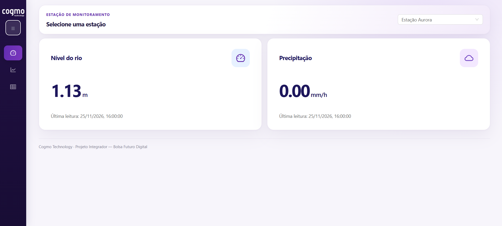
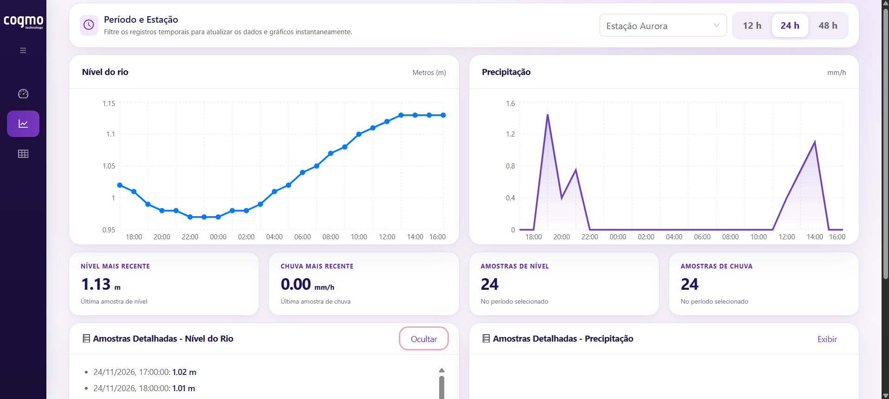
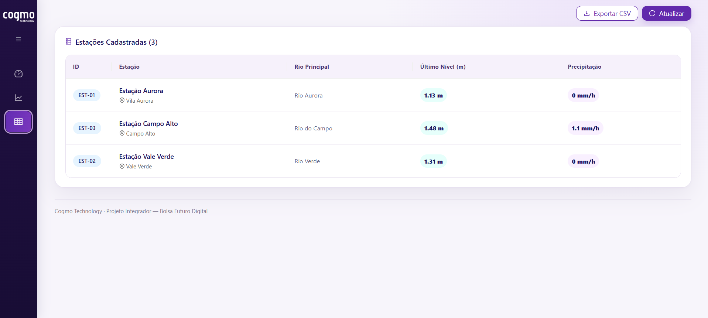
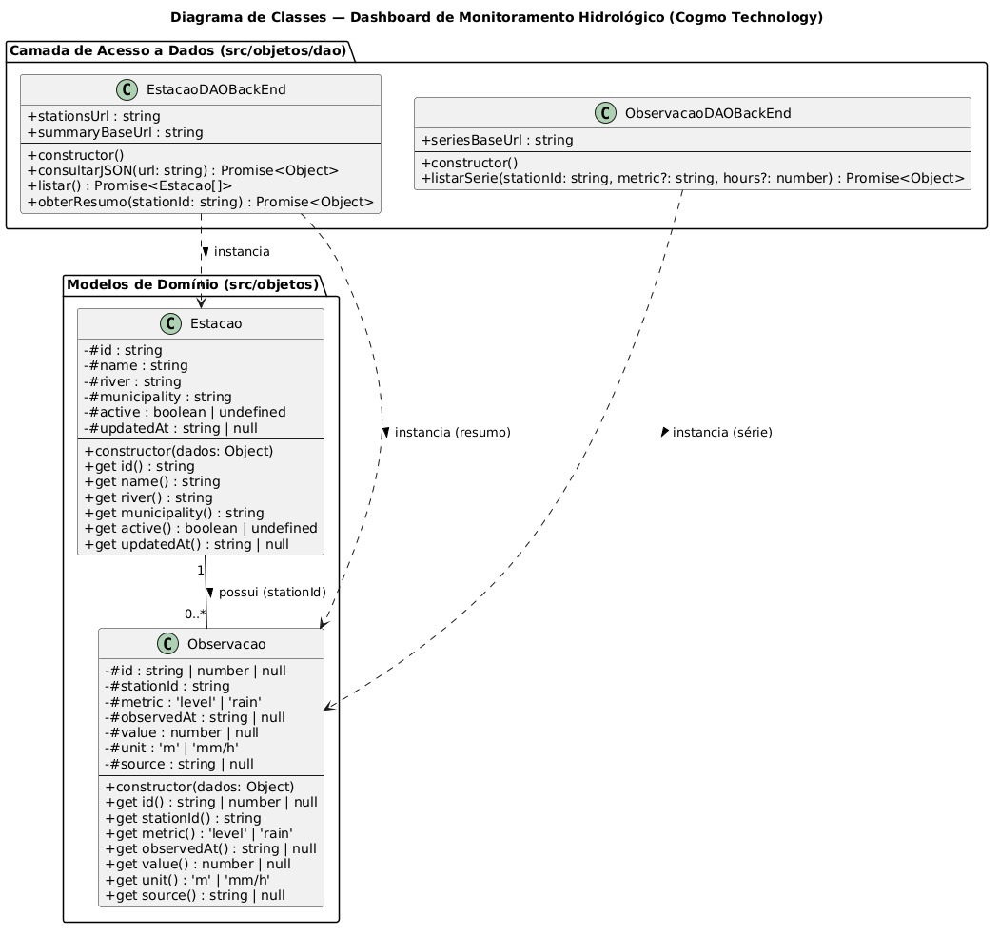

# Dashboard de Monitoramento Hidrológico

Projeto Integrador — **Bolsa Futuro Digital (BFD)** · Empresa parceira: **Cogmo Technology**

Dashboard web que apresenta o nível de rios (m) e a precipitação (mm/h) de três estações de monitoramento **fictícias**. O problema proposto pela Cogmo é dar a quem acompanha as estações uma visão rápida e confiável das últimas leituras e do histórico recente. A solução é uma aplicação ReactJS com três telas (Visão Geral, Histórico de Medições e Consulta de Medições) que consome uma API REST simulada, publicada em n8n.

> ⚠️ **Todos os dados são simulados.** Não representam condições hidrológicas reais e não devem ser usados para decisões de segurança.

<h2>Acesse o Projeto</h2>

<p align="center">
<a href="https://desafio-cogmo-ifb-1.vercel.app/" target="_blank" rel="noopener noreferrer">

</a>
</p>


## 1. Deploy da aplicação

| Item | Situação |
| --- | --- |
| Frontend publicado | **Não publicado.** A aplicação roda localmente (ver [seção 13](#13-execução-local)). |
| API (n8n, produção) | Publicada. Endpoints na [seção 11](#11-integração-com-api-rest). |

## 2. Repositórios do projeto

- Frontend (este repositório): <https://github.com/mjsoweb/DesafioCogmoIFB>
- Não há repositório de backend: a API é um mock publicado em n8n, mantido pela Cogmo/professor.

## 3. Visão geral

- **Domínio:** monitoramento hidrológico.
- **Entidades principais:** `Estacao` (id, name, river, municipality) e `Observacao` (leitura de uma métrica: `level` em m ou `rain` em mm/h).
- **Objetivo:** consultar estações, a última leitura de cada métrica e séries históricas de 12, 24 e 48 horas.
- **Origem dos dados:** API REST simulada (n8n), somente leitura (`GET`). Os dados são gerados em JavaScript no n8n, a partir do horário da requisição; **não há banco de dados nem conexão real com SQLite**. Persistência no frontend: nenhuma.

## 4. Tecnologias utilizadas

| Tecnologia | Uso |
| --- | --- |
| ReactJS 19 + JavaScript (módulos ES) | Interface e componentes |
| Vite 8 | Servidor de desenvolvimento e build |
| Ant Design 6 + @ant-design/icons | Layout, menu, cartões, tabela, seletores, alertas |
| React Router DOM 7 | Navegação entre as três telas |
| Recharts 3 | Gráficos de nível e chuva |
| `fetch`, Promises, `async/await` | Consumo da API |
| oxlint | Verificação estática do código |

## 5. Desafio atendido

**Implementado:**

- Três telas com layout compartilhado e menu lateral (recolhível no desktop, em gaveta no celular).
- Camada de domínio com classes `Estacao` e `Observacao` (atributos privados `#`, getters e validações).
- DAOs assíncronos `EstacaoDAOBackEnd` e `ObservacaoDAOBackEnd`, que consomem a API.
- Tratamento separado de **nível (m)** e **chuva (mm/h)**, cada leitura com seu próprio horário.
- Estados de carregamento, erro e lista vazia, sem travar a interface.
- Exportação CSV da tela de consulta.
- Aviso de dados simulados em todas as telas.

**Limitações conhecidas:**

- A interface oferece janelas de 12, 24 e 48 h; a API aceita de 1 a 72 h (todas validadas em `npm run demo:dao`).
- A tabela da Consulta de Medições mostra a última leitura de cada estação, sem coluna de horário e sem filtros.
- Os erros 400/404 não são provocáveis pela interface (os controles só enviam valores válidos); são tratados nos DAOs e verificados por `npm run demo:dao`.
- Aplicação não publicada; capturas de tela e testes de reprodução dependem da equipe (ver seção 9).

## 6. Requisitos funcionais (RF)

| Código | Requisito | Situação |
| --- | --- | --- |
| RF01 | Listar as estações em ordem alfabética | Atendido |
| RF02 | Exibir a última leitura de nível (m) e de chuva (mm/h), com horários independentes | Atendido |
| RF03 | Selecionar a estação e atualizar os dados sem recarregar a página | Atendido |
| RF04 | Exibir séries históricas de nível e chuva em gráficos separados, com janela selecionável | Atendido (12/24/48 h; ver limitações) |
| RF05 | Consultar as estações cadastradas com suas últimas leituras e exportar em CSV | Parcial (sem horário da leitura e sem filtros na tabela) |
| RF06 | Tratar carregamento, erro de conexão, HTTP 400/404 e série vazia | Atendido |
| RF07 | Identificar que os dados são simulados | Atendido |

## 7. Requisitos não funcionais (RNF)

| Código | Requisito | Situação |
| --- | --- | --- |
| RNF01 | Arquitetura em camadas: componentes/páginas → DAO → modelo | Atendido |
| RNF02 | Encapsulamento dos modelos (atributos privados, getters, validação de métrica e unidade) | Atendido |
| RNF03 | Responsividade (desktop, tablet e celular), com menu adaptável e lista de cartões no celular | Atendido |
| RNF04 | Integração apenas por `GET`, com URLs em variáveis de ambiente e sem segredos | Atendido |
| RNF05 | Não misturar unidades nem interpolar lacunas; série vazia é válida | Atendido |
| RNF06 | Evitar que respostas antigas sobrescrevam a seleção atual (flag `ativo` nos `useEffect`) | Atendido |
| RNF07 | Código verificado por lint e build | Atendido (`npm run lint`: 0 avisos; `npm run build`: sucesso) |

## 8. Telas da aplicação

> As imagens abaixo devem estar em `docs/imagens/` (veja [docs/imagens/LEIA-ME.md](docs/imagens/LEIA-ME.md)).
> 
**Versão mobile:** https://drive.google.com/file/d/1NLEd6Hp1-eZ4DzqD3EKwegMjJ1LbRevw/view?usp=drivesdk
> 
**Visão Geral:** seleção de estação e cartões de nível (m) e precipitação (mm/h), cada um com seu horário.



**Histórico de Medições:** filtros de estação e período (12/24/48 h), gráficos separados de nível e chuva, indicadores e amostras detalhadas.



**Consulta de Medições:** tabela de estações cadastradas com últimas leituras e botão de exportação CSV.



## 9. Evidências e testes

- `npm run build` e `npm run lint` executam sem erros.
- `npm run demo:dao` consulta a API publicada e verifica: as três estações (ordem alfabética), resumo de cada uma, as duas métricas, janelas de 1, 12, 24 e 72 h, instâncias das classes de domínio, ordenação cronológica e os erros `station_not_found` (404), `invalid_metric` e `invalid_hours` (400).

## 10. Modelagem dos dados

| Classe | Atributos (privados) | Observações |
| --- | --- | --- |
| `Estacao` | `id`, `name`, `river`, `municipality`, `active`, `updatedAt` | `active` não vem de `/stations` (fica `undefined`); `updated_at` é metadado da resposta |
| `Observacao` | `id`, `stationId`, `metric`, `observedAt`, `value`, `unit`, `source` | `metric` ∈ {`level`, `rain`}; `unit` deve ser `m` (level) ou `mm/h` (rain); `value` e `observedAt` podem ser `null` |

Relacionamento: uma `Estacao` possui várias `Observacao` (1:N, ligadas por `stationId`).

Os pontos de série da API trazem só `timestamp` e `value`; por isso `id` e `source` ficam `null` nas `Observacao` criadas a partir delas (nenhum identificador é inventado).

**Diagrama de classes (UML):** [imagem](docs/uml/diagrama-classes.png) · [fonte PlantUML](docs/uml/diagrama-classes.puml)



## 11. Integração com API REST

A API oferece **somente GET** e dados simulados. Os UUIDs nos caminhos de Summary e Series fazem parte das URLs de produção do n8n e devem ser preservados.

| Método | Endpoint | Descrição |
| --- | --- | --- |
| GET | `https://n8n.incluc0de.com.br/webhook/cogmo/api/health` | Estado do serviço. `database: ok` é simulado, sem conexão real com SQLite |
| GET | `https://n8n.incluc0de.com.br/webhook/cogmo/api/stations` | Estações em objeto com `data_mode` e `stations` |
| GET | `https://n8n.incluc0de.com.br/webhook/ca01b8a8-6b9c-42ab-b126-3bc5bc27bcb3/cogmo/api/stations/EST-01/summary` | Última leitura de nível e de chuva, cada uma com seu horário |
| GET | `https://n8n.incluc0de.com.br/webhook/2ee3441c-7147-401d-a504-73eedb917573/cogmo/api/stations/EST-01/series?metric=rain&hours=24` | Série histórica |

**Parâmetros:** troque `EST-01` por `EST-02` ou `EST-03`. Em Series, `metric` aceita `level` (m) ou `rain` (mm/h; padrão `level`) e `hours` aceita inteiros de 1 a 72 (padrão 24).

**Exemplo — Series (parcial):**

```json
{
  "data_mode": "simulation",
  "station_id": "EST-01",
  "metric": "rain",
  "unit": "mm/h",
  "interval_minutes": 60,
  "from": "2026-11-11T12:00:00.000Z",
  "to": "2026-11-12T12:00:00.000Z",
  "points": [{ "timestamp": "2026-11-11T13:00:00.000Z", "value": 0.0 }]
}
```

Uma série vazia (`"points": []`) é válida; o frontend não preenche nem interpola lacunas.

**Erros:**

| Situação | HTTP | `error.code` |
| --- | --- | --- |
| Estação desconhecida | 404 | `station_not_found` |
| `metric` diferente de `level`/`rain` | 400 | `invalid_metric` |
| `hours` não inteiro ou fora de 1–72 | 400 | `invalid_hours` |

Formato: `{"error":{"code":"station_not_found","message":"Estação não encontrada."}}`. Os DAOs verificam `response.ok`, convertem o erro em `Error` com `code` e `status`, e as telas mostram a mensagem em um `Alert`, sem stack trace.

## 12. Estrutura do projeto frontend

```text
.
├── docs/
│   ├── imagens/                  # capturas de tela
│   ├── uml/                      # diagrama de classes (.puml, .png, .svg)
│   └── arquivo/                  # cópias históricas de modernização visual
├── public/                       # logotipos da Cogmo
├── scripts/
│   └── demonstrar-daos.mjs       # teste dos DAOs contra a API (npm run demo:dao)
├── src/
│   ├── componentes/              # LayoutPrincipal, AvisoSimulacao e componentes de apoio
│   ├── paginas/                  # VisaoGeral, HistoricoMedicoes, ConsultaMedicoes
│   ├── objetos/
│   │   ├── estacoes/Estacao.mjs
│   │   ├── observacoes/Observacao.mjs
│   │   └── dao/                  # EstacaoDAOBackEnd.mjs, ObservacaoDAOBackEnd.mjs
│   ├── api/                      # mock e tipos históricos da Sprint 5 (fora do fluxo atual)
│   ├── dados/, dadosEstacoes.json# dados locais das Sprints 3–4 (fora do fluxo atual)
│   ├── App.jsx, main.jsx         # rotas e tema Ant Design
│   └── *.css                     # estilos, tema e responsividade
├── .env.example                  # URLs públicas dos Webhooks
├── CONTRATO_API_*.md, MODELO_DE_DADOS.md
└── package.json, vite.config.js, index.html
```

## 13. Execução local

**Pré-requisitos:** Node.js 20.19 ou superior (ou 22.12+) e npm.

```bash
git clone https://github.com/mjsoweb/DesafioCogmoIFB.git
cd DesafioCogmoIFB
npm install
cp .env.example .env.local      # Windows (PowerShell): Copy-Item .env.example .env.local
npm run dev
```

Abra o endereço exibido pelo Vite (normalmente <http://localhost:5173>).

**Variáveis de ambiente** (`.env.local`; as URLs reais já estão em `.env.example`):

| Variável | Conteúdo |
| --- | --- |
| `VITE_COGMO_STATIONS_URL` | URL completa de GET stations |
| `VITE_COGMO_SUMMARY_BASE_URL` | URL de GET summary, até `/stations` |
| `VITE_COGMO_SERIES_BASE_URL` | URL de GET series, até `/stations` |

Reinicie o Vite após alterar o `.env.local`. Variáveis `VITE_` são públicas no navegador: não coloque segredos nelas.

**Outros comandos:** `npm run build` (compilação), `npm run lint` (verificação), `npm run demo:dao` (testa os DAOs contra a API; requer internet).

## 14. Autoria

- Maria Júlia Santos Oliveira, Thalita e Samantha Raquel de Assis Corrêa
- Curso de Front-end — Instituto Federal de Brasília (IFB)
- Projeto Integrador — Bolsa Futuro Digital (BFD), em parceria com a Cogmo Technology

## 15. Considerações finais

O projeto cumpre o desafio proposto: três telas integradas a uma API REST, camada de domínio encapsulada, DAOs assíncronos e tratamento separado de nível e chuva. A evolução ocorreu em sprints: estrutura e navegação (S1), componentes (S2), JSON local (S3), estados (S4), modelos e DAOs (S5) e integração HTTP (S6).

**Dificuldades:** conviver com URLs distintas por Webhook (UUIDs no n8n) e evitar respostas antigas sobrescrevendo a seleção atual.

**Possíveis melhorias:** publicar o frontend; oferecer a janela de 72 h na interface; exibir o horário de cada leitura e filtros na Consulta de Medições; remover os arquivos históricos (`src/api`, `src/dados`); adicionar testes automatizados.

